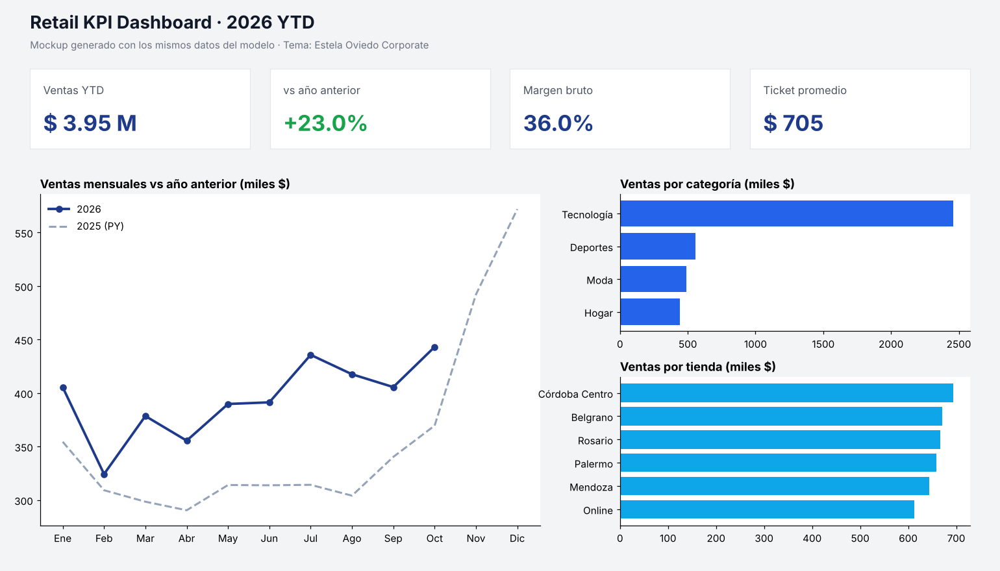

<div align="center">

# 📈 Retail KPI Semantic Model — Power BI

**Modelo semántico listo para IA: esquema estrella, Power Query parametrizado, 24 medidas DAX y tema corporativo.**


</div>

---

## 🎯 Problema que resuelve

Muchos tableros de Power BI son "una tabla gigante + medidas sueltas": lentos, difíciles de mantener y **poco confiables para Copilot y los agentes de IA**, que necesitan un modelo semántico limpio para responder bien. En 2026 Microsoft integró agentes y Copilot directamente sobre los modelos semánticos de Power BI y Fabric: un modelo bien diseñado ya no es un detalle técnico, es la base de la IA de la empresa.

## 💡 Solución

Una plantilla profesional de modelo semántico para retail:

- **Esquema estrella**: `FactSales` + `DimDate`, `DimProduct`, `DimStore`, `DimCustomer`.
- **Power Query parametrizado** (`DataFolder`), función reutilizable `fnLoadCsv` y calendario dinámico.
- **24 medidas DAX** organizadas por carpetas: base, inteligencia de tiempo, rentabilidad, clientes y UX (títulos dinámicos, semáforos).
- **Tema JSON** corporativo coherente.
- **Valores esperados** calculados en Python para validar que cada medida devuelve el número correcto.

## 🛠️ Tecnologías usadas

`Power BI Desktop` · `Power Query (M)` · `DAX` · `Python + pandas` (datos y validación) · `JSON` (tema)

## ✅ Beneficios

- ⚡ Modelo eficiente: importes calculados en Power Query, relaciones 1:* de una sola dirección.
- 🤖 **AI-ready**: nombres claros y medidas explícitas → mejores respuestas de Copilot / agentes de datos.
- 🧪 **Validado**: tabla de valores esperados para comprobar cada KPI.
- ♻️ Reutilizable: cambiá la carpeta de datos y el informe se actualiza.

## 📸 Capturas


<sub>Mockup del tablero generado con los mismos datos del modelo. La captura del .pbix se agrega al construirlo (ver guía).</sub>

```
DimDate ──1:*──┐
DimProduct ─1:*┤
DimStore ──1:*─┼──► FactSales (17.308 filas · 2024-01 a 2026-10)
DimCustomer 1:*┘
```

## ⚙️ Instalación

```bash
git clone https://github.com/Rumenco1221/powerbi-retail-kpi-semantic-model.git
cd powerbi-retail-kpi-semantic-model
pip install -r requirements.txt
python scripts/generate_star_schema.py   # (re)genera los CSV de /data
python scripts/expected_values.py        # valores esperados + mockup
```

## ▶️ Uso

Seguí la guía paso a paso **[`docs/BUILD_GUIDE.md`](docs/BUILD_GUIDE.md)** (≈ 30 minutos):
1. Crear el parámetro `DataFolder`.
2. Pegar las consultas de [`powerquery/`](powerquery).
3. Crear relaciones y marcar `DimDate` como tabla de fechas.
4. Pegar las medidas de [`dax/Measures.dax`](dax/Measures.dax).
5. Importar el tema [`theme/estela_corporate_theme.json`](theme/estela_corporate_theme.json).
6. Validar contra [`docs/EXPECTED_VALUES.md`](docs/EXPECTED_VALUES.md).

## 🗺️ Roadmap

- [x] Modelo estrella + Power Query + DAX + tema
- [ ] Archivo `.pbip` (formato proyecto) para control de versiones nativo en Git
- [ ] Grupos de cálculo para inteligencia de tiempo
- [ ] Seguridad a nivel de fila (RLS) por región
- [ ] Descripciones de medidas optimizadas para Copilot / agentes de datos

## 🤝 Contribuciones

Propuestas de medidas nuevas: abrí un *issue* con la definición de negocio y el resultado esperado.

## 📬 Contacto

**Estela Oviedo** — Power BI · Power Query · DAX · Data Analytics
[LinkedIn](https://www.linkedin.com/in/estela-oviedo-cortez-796303228) · [GitHub](https://github.com/Rumenco1221)

---
<sub>Licencia MIT · Datos sintéticos.</sub>
